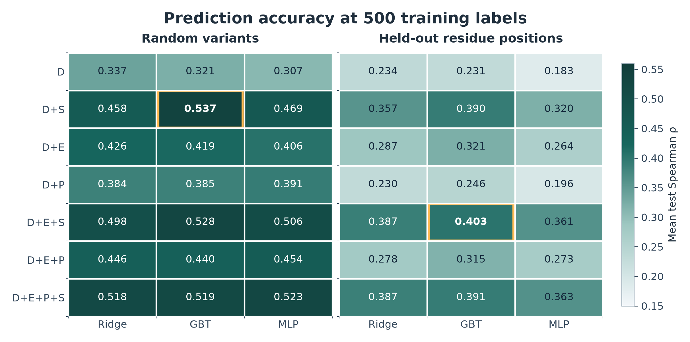
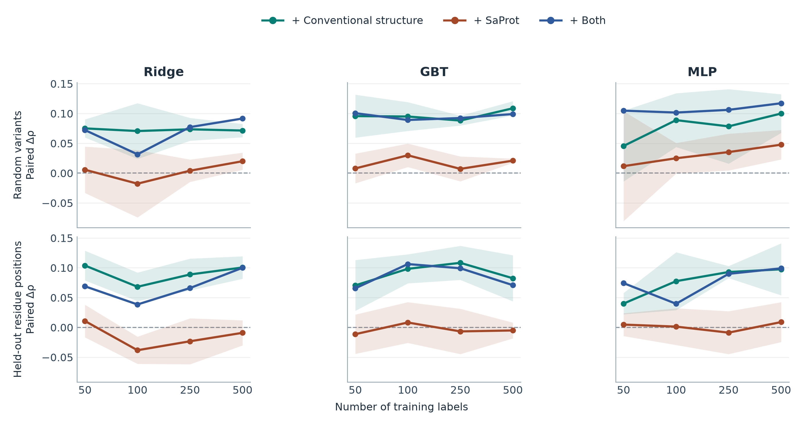
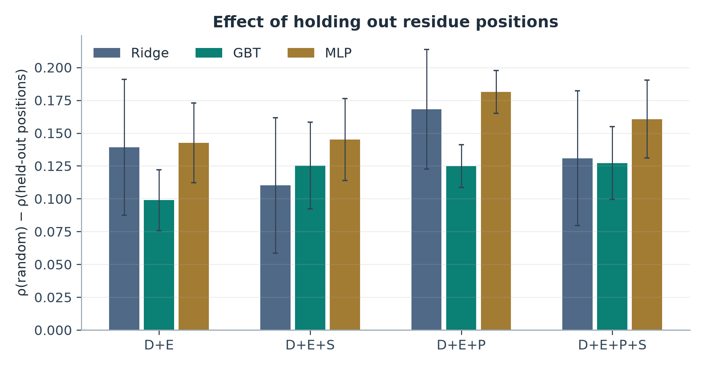
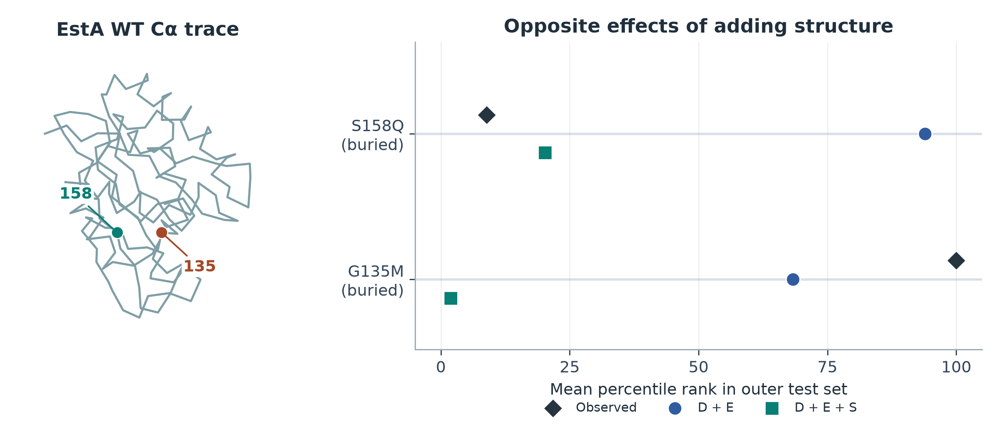

# When Do Structural Features Complement Protein Language Models in Predicting Mutational Effects?

Yu-Hsin Chen, Ziyi Huang, and Wenxin Zhang · COBB 2035 · Fall 2026

## Abstract

Protein language models encode information about protein sequences, and the benefit of adding explicit structural information may depend on the representation and evaluation protocol. We studied 6,000 single substitutions across four ProteinGym assays and compared frozen ESM-2 and SaProt embeddings with explicit wild-type structural features. We fit ridge regression, gradient-boosted trees, and a regularized multilayer perceptron with 50–500 labels and evaluated random and position-held-out splits. With 500 labels and unseen test positions, conventional features increased the mean Spearman correlation by 0.082–0.101 over the ESM-2 baseline across the three models. Adding the SaProt embedding to that baseline changed the correlation by −0.009 to +0.009. The best configuration for held-out positions reached 0.403 with gradient-boosted trees, ESM-2, and conventional structure. The tested structural features were most helpful for EstA thermostability and less useful for the TrpC growth-based fitness assay. For these four assays, the representation and the difficulty of the test split mattered more than simply combining every feature block.

## Research question

We asked whether explicit structural descriptors or a structure-aware language-model representation improve single-substitution effect prediction beyond a sequence language model. We compared their gains as the label budget, regression model, and test split changed. We also checked whether the gains concentrate at buried positions, where substitution effects could be influenced by packing interactions.

## Dataset

We chose four structurally distinct targets with available ProteinGym v1.3 wild-type AlphaFold2 reference structures and enough single substitutions for the prespecified 500-label budget [1, 6–9]. After removing non-single substitutions and nonfinite labels, we checked each reference amino acid and reconstructed the full reported mutant sequence. All eligible singles mapped to annotated coordinates. We sampled 1,500 variants per assay with a fixed, label-independent seed and used the curated DMS score as provided, with higher scores denoting higher assay performance.

| Assay | Readout | Eligible singles | Sampled sites | Selected singles |
|---|---|---:|---:|---:|
| PHOT (CreiLOV) | Fluorescence | 2,122 | 118 | 1,500 |
| EstA (lipase A) | Thermostability | 2,172 | 167 | 1,500 |
| TrpC (IGPS) | Growth-based fitness | 1,519 | 80 | 1,500 |
| HMBS | Activity | 5,689 | 338 | 1,500 |

<!-- pagebreak -->

## Methods

### Feature representations

**D (substitution descriptors).** One-hot amino-acid identities for wild type and mutant, BLOSUM62 substitution score, and mutant-minus-wild-type changes in hydropathy, molecular weight, and approximate side-chain charge. Histidine was treated as neutral for the charge descriptor.

**S (conventional structure).** DSSP relative solvent accessibility (RSA) normalized with the Tien–Wilke scale [5], three secondary-structure classes, and the number of intrachain Cα neighbors within 8 Å, excluding the mutated position and its two immediate sequence neighbors on either side. The structural annotations describe the wild-type reference.

**E (sequence embedding).** For each mutant and its wild-type sequence, the frozen ESM-2 35M encoder [2] produced a 480-dimensional final-layer vector at the substituted position. The representation is the mutant vector minus the wild-type vector at that position.

**P (structure-aware embedding).** Foldseek encoded the wild-type structure as a sequence of 3Di states [3, 4]. In the SaProt-35M-AF2 input, each residue combines its amino acid with a 3Di state. The mutant changed the amino-acid component while retaining the wild-type 3Di states throughout the chain. We masked states at pLDDT below 70 and took the same 480-dimensional mutant-minus-wild-type difference. **Q** denotes the separate SaProt-35M sequence-only checkpoint used as an additional Ridge control with the same embedding dimension.

### Fitting, splits, and evaluation

We fit each assay independently. We evaluated seven combinations of D, S, E, and P under ridge regression, histogram-based gradient boosting (GBT), and a 64/16-unit MLP with 20% dropout, AdamW weight decay, and validation-based early stopping. A separate Ridge experiment evaluated D+E+Q. Each embedding block was reduced to 24 principal components using only fit rows and scaled along with the other blocks. Every head and feature set used the same test IDs and nested training budgets of 50, 100, 250, and 500 labels. Validation and hyperparameter tuning used only labels within the respective budget. After selection, preprocessing and the model were refit on that budget.

For each assay and five seeds, the position-held-out split assigned about one quarter of mutated positions to the test set and kept all their mutations there. Inner validation also held out whole positions. The corresponding random split matched the test-set size and sampled individual variants. Each outer test set contained 359–399 variants and stayed fixed across label budgets. We calculated Spearman ρ separately in each test fold and weighted the four assays equally after averaging over seeds. A paired change Δρ subtracts the D+E result using the same head, assay, train budget and split. Environment-specific scores require at least 30 variants and eight distinct test positions. The environment comparison uses only folds with both groups.

<!-- pagebreak -->

## Results

### Conventional structure improves generalization to unseen sites

At 500 labels, the strongest position-held-out configuration was GBT with D+E+S (ρ = 0.403), compared with 0.321 using D+E. Ridge reached 0.387 and the MLP reached 0.361 with D+E+S. Their paired gains were +0.101 and +0.097. GBT with D+S alone reached 0.390 on held-out positions and led the random split at 0.537. The gain from adding conventional structure therefore appears in both linear and nonlinear models.

Conventional structure helped on average at all four budgets for all three models on held-out positions (Δρ +0.040 to +0.108). The size of the gain varied with the head and budget. SaProt gains were smaller and inconsistent on held-out positions. With 500 labels, adding SaProt improved all random-split means (+0.020 to +0.048), but changed held-out means by −0.009 to +0.009. In the Ridge control, D+E+P scored 0.278 against 0.317 for D+E+Q on held-out positions, a paired difference of −0.039 for the structure-aware checkpoint.

<!-- pagebreak -->

## Where did the gains occur?

### Assay and structural environment

At 500 labels on held-out positions, the gain from D+E+S over D+E was +0.237 to +0.267 for EstA, +0.084 to +0.107 for PHOT, and +0.018 to +0.057 for HMBS across heads. TrpC returned −0.025 to −0.007. Pooling assay-level results would hide this heterogeneity. In particular, EstA contributed a large share of the mean gain.

The matched analysis did not support the expected advantage at buried positions. For conventional structure, Ridge gained +0.044 at buried sites and +0.066 at exposed sites. Point estimates for all three heads favored exposed sites, with sizeable split-to-split variation. TrpC had too few distinct exposed positions in every held-out test split and was excluded from both bars in this comparison. The positive whole-assay gain can also arise from improving the ordering between structural environments, which the within-environment correlations do not measure.

### Random testing is easier on average

At 500 labels, random-split means were higher for each tested configuration. The difference for D+E was 0.099–0.143 across heads. Adding SaProt widened that descriptive gap across all three heads. The gap compares two protocols and test memberships. Unseen sites in the same protein are the intended target of the position-held-out evaluation.

<!-- pagebreak -->

## Structural examples and limitations

Both EstA sites are buried (RSA = 0). S158 is in a strand and has 12 Cα neighbors, while G135 is in a coil and has 14. For S158Q, whose observed rank was the 9th percentile, adding structure moved Ridge’s prediction from the 94th to the 20th percentile. For G135M, the observed rank was the 100th percentile and the prediction moved from the 68th to the 2nd percentile. The cases illustrate opposite errors within the same local-environment category. The reference structure leaves mutant conformations and the causal origin of each error unresolved.

This is a four-assay, within-protein benchmark using one predicted wild-type conformation per target. Assays measure different biological readouts and the repeated test splits overlap. The comparisons are descriptive. SaProt used a particular 35M checkpoint, retained wild-type geometry, and was compressed to 24 principal components. The separate sequence-only checkpoint also has a different pretraining input. These choices limit interpretation of the near-zero gains. Future work could test additional protein families, directly vary the 3Di input within a single checkpoint, and examine sensitivity to embedding dimensionality.

## Conclusion

Conventional structure complemented ESM-2 on average across all three heads and four training budgets when generalizing to held-out positions. The SaProt representation yielded larger gains under random-split evaluation than at unseen sites at the 500-label budget. Reporting both protocols and the per-assay effects makes the scope of these conclusions clear.

## References

1. Notin et al. ProteinGym. *NeurIPS*, 2023. [Paper](https://papers.nips.cc/paper_files/paper/2023/hash/cac723e5ff29f65e3fcbb0739ae91bee-Abstract-Datasets_and_Benchmarks.html) · [v1.3 data](https://zenodo.org/records/15293562)
2. Lin et al. Evolutionary-scale prediction of atomic-level protein structure with a language model. *Science*, 2023. [DOI](https://doi.org/10.1126/science.ade2574)
3. Su et al. SaProt. *ICLR*, 2024. [Paper](https://proceedings.iclr.cc/paper_files/paper/2024/file/1c42513b8895ab11fbbb5b7e8e6b6b02-Paper-Conference.pdf)
4. van Kempen et al. Fast and accurate protein structure search with Foldseek. *Nature Biotechnology*, 2024. [DOI](https://doi.org/10.1038/s41587-023-01773-0)
5. Tien et al. Maximum allowed solvent accessibilities of residues in proteins. *PLOS ONE*, 2013. [DOI](https://doi.org/10.1371/journal.pone.0080635)
6. Chen et al. Mutational scanning of CreiLOV. *ACS Synthetic Biology*, 2023. [DOI](https://doi.org/10.1021/acssynbio.2c00662)
7. Nutschel et al. Thermostability of *B. subtilis* lipase A. *JCIM*, 2020. [DOI](https://doi.org/10.1021/acs.jcim.9b00954)
8. Chan et al. Fitness landscapes of orthologous TIM barrels. *Nature Communications*, 2017. [DOI](https://doi.org/10.1038/ncomms14614)
9. van Loggerenberg et al. Testing human HMBS missense variants. *AJHG*, 2023. [DOI](https://doi.org/10.1016/j.ajhg.2023.08.012)

**AI assistance.** Codex assisted with implementation, verification, and drafting. The scientific figures were rendered from the computed benchmark outputs and reference coordinates with the accompanying Python scripts.
